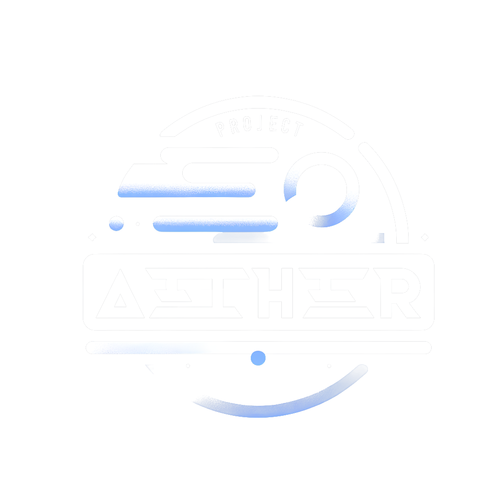

<div align="center"></div>
<h2 align="center">A performant, cross-platform game engine</h2>

## What is Aether?

Aether is a crossplatform game engine written in [Zig](https://ziglang.org/). The same game code runs on desktop (Windows, Linux, macOS), in the browser, and on the PSP, Nintendo 3DS, and Nintendo Switch.

User code is structured as hooks into the engine via a `State` interface. You implement the game logic, the engine handles the rest for you.

## Features

- **Cross-platform**: Windows, Linux, macOS, browser (WASM), PSP, Nintendo 3DS, Nintendo Switch
- **Graphics backends**: Vulkan (desktop default) and OpenGL 4.5 on desktop. WebGL in the browser, native GPU backends on consoles. Headless mode for servers.
- **Fixed-step game loop**: 144 Hz updates on desktop (60 Hz on consoles and web), 20 Hz ticks, uncapped rendering
- **Action-based input**: keyboard, mouse, and gamepad bindings, context stacks, text input sessions, and rebinding
- **2D and 3D helpers**: cameras, transforms, sprite sheets, flipbooks, billboard batching, and a float `Color` type
- **Audio**: a mixer with 3D positional playback, resident WAV buffers, streaming sounds, and a tiny chiptune-style synth
- **Immediate-mode UI**: bounded draw lists, widgets, text wrapping, sprite and font batching, and scaling
- **Static budgeted memory pools**: `render`, `audio`, `frame`, and `user` -- carved from one block you hand the engine. No hidden allocations.

## Requirements

- Zig **0.18.0-dev.146+35accc06e** or later (see `build.zig.zon`)

Everything is fetched by the Zig package manager: SDL3 is built from source and linked statically, Vulkan headers and the Slang shader compiler are downloaded at build time.

Per-target extras:

| Target | Needs |
|--------|-------|
| macOS | MoltenVK (`brew install molten-vk`, or point `-Dmolten-vk-path` at it). Must be build on a mac. |
| Browser | `spirv-cross` on `PATH` (or `-Dspirv-cross-path`) |
| Switch | [devkitPro](https://devkitpro.org/) with devkitA64 and libnx (`$DEVKITPRO` or `-Ddevkitpro-path`) |

## Getting Started

Add Aether as a dependency:

```sh
zig fetch --save=engine git+https://github.com/AetherEngine/Aether
```

Then set up your `build.zig`:

```zig
const std = @import("std");
const Aether = @import("engine");

pub fn build(b: *std.Build) void {
    const target = b.standardTargetOptions(.{});
    const optimize = b.standardOptimizeOption(.{});

    // Optional: allow overriding the graphics backend with -Dgfx=opengl
    const overrides: Aether.config.Config.Overrides = .{
        .gfx = b.option(Aether.config.Gfx, "gfx", "Graphics backend override (default: auto-detect from target)"),
    };

    const config = Aether.config.Config.resolve(target, overrides);

    const ae_dep = b.dependency("engine", .{
        .target = target,
        .optimize = optimize,
    });

    const exe = Aether.modules.add_game(ae_dep.builder, b, .{
        .name = "my_game",
        .root_source_file = b.path("src/main.zig"),
        .target = target,
        .optimize = optimize,
        .overrides = overrides,
    });

    // Produces EBOOT.PBP on PSP, .3dsx on 3DS, .nro on Switch, a .app on
    // macOS, a web bundle for WASM, and a plain install elsewhere.
    Aether.packaging.export_artifact(ae_dep.builder, b, exe, config, .{
        .title = "My Game",
        .resources = &.{
            .{ .path = b.path("assets/player.png"), .name = "player.png" },
        },
    });

    const run_step = b.step("run", "Run the game");
    run_step.dependOn(&Aether.packaging.add_run_step(exe, config).step);
}
```

The first argument to `modules.add_game` and `packaging.export_artifact` is the dependency's builder (`ae_dep.builder`), and the second is your project's builder (`b`). This lets Aether resolve its own dependencies from its `build.zig.zon` while building artifacts that belong to your project.

The returned executable's root is Aether's platform entry (`platform/root/`). Add imports for your game code through `user_root_module`:

```zig
Aether.modules.user_root_module(exe).addImport("my_module", my_module);
```

Then write your game:

```zig
const std = @import("std");
const ae = @import("aether");

pub const aether_options: ae.Options = .{
    .title = "My Game",
    .app_name = "my_game",
    .psp = .{
        .module_name = "MyGame",
        .stack_size = 256 * 1024,
    },
};

const MyState = struct {
    fn init(ctx: *anyopaque, engine: *ae.Engine) anyerror!void {
        const self = ae.ctx_to_self(MyState, ctx);
        _ = self;
        _ = engine;
    }
    fn deinit(ctx: *anyopaque, engine: *ae.Engine) void { _ = ctx; _ = engine; }
    fn tick(ctx: *anyopaque, engine: *ae.Engine) anyerror!void { _ = ctx; _ = engine; }
    fn update(ctx: *anyopaque, engine: *ae.Engine, dt: f32, _: *const ae.Util.BudgetContext) anyerror!void { _ = ctx; _ = engine; _ = dt; }
    fn draw(ctx: *anyopaque, engine: *ae.Engine, dt: f32, _: *const ae.Util.BudgetContext) anyerror!void { _ = ctx; _ = engine; _ = dt; }

    pub fn state(self: *MyState) ae.Core.State {
        return .{ .ptr = self, .tab = &.{
            .init = init, .deinit = deinit,
            .tick = tick, .update = update, .draw = draw,
        } };
    }
};

pub fn main(init: std.process.Init) !void {
    const memory_config: ae.Util.MemoryConfig = .{
        .render = 8 * 1024 * 1024,
        .audio = 2 * 1024 * 1024,
        .frame = 2 * 1024 * 1024,
        .user = 16 * 1024 * 1024,
    };
    const memory = try init.gpa.alignedAlloc(u8, .fromByteUnits(16), memory_config.total());
    defer init.gpa.free(memory);

    var my_state: MyState = undefined;
    var engine: ae.Engine = undefined;
    try engine.init(init.io, init.environ_map, memory, &.{
        .memory = memory_config,
        .title = aether_options.title,
        .app_name = ae.AppOptions.resolve_app_name(aether_options),
        .resizable = true,
    }, &my_state.state());
    defer engine.deinit();

    engine.run() catch |err| switch (err) {
        error.StateTransitionFailed => {
            if (engine.last_transition_failure()) |state_err| {
                ae.Util.game_logger.err("state transition failed: {s}", .{@errorName(state_err)});
            }
            return error.EngineStateTransitionFailed;
        },
        else => return err,
    };
}
```

`tick` runs at a fixed 20 Hz for game logic, `update` at a fixed 144 Hz on desktop (60 Hz on consoles and web) for simulation and animation, and `draw` once per rendered frame. An optional `ui_update` hook runs between update and draw. Switch states with `engine.transition(&next.state())` and stop with `engine.quit()`.

Each pool is a separate budget: get its allocator with `engine.allocator(.render)` and so on, and use `engine.frame_allocator()` for scratch memory that is reset every frame. Set `.frame = 0` to disable the frame allocator. 

`engine.report()` logs per-pool usage and high-water marks.

Platform and graphics backend are comptime constants, so budgets and features can be configured per target:

```zig
const memory_config: ae.Util.MemoryConfig = switch (ae.platform) {
    .psp => .{ .render = 512 * 1024, .audio = 256 * 1024, .frame = 128 * 1024, ... },
    else => .{ .render = 8 * 1024 * 1024, .audio = 2 * 1024 * 1024, .frame = 2 * 1024 * 1024, ... },
};
```

Target-specific services are exposed as `ae.Psp` (system dialogs), `ae.N3ds` (New-model detection), and `ae.Web` (file downloads); each is `void` on other targets.

### I/O and threads

Aether owns every target's entry point, so `main` always receives `std.process.Init`. `init.io` is the target's Io, completed by Aether where it lacks concurrency: `io.async`, `io.concurrent`, and `std.Io.Group` run on std's thread pool (desktop), PSP kernel threads, or libnx threads (Switch). The browser and 3DS run `async` inline and report `concurrent` unavailable.

For threads with a specific name, stack size, or priority, or on any target with native threads (`ae.System.info().background_workers`, which includes 3DS), use `ae.Util.Thread`; scope the calling thread's priority with `ae.Util.PriorityScope`.

### Browser

In the browser, `engine.run()` hands the loop to the page and returns immediately, so keep the engine and its memory in static storage instead of deinitializing after `run` (see `test/web_main.zig`).

## Input System

Actions are registered by name on `engine.input` and bound to one or more
sources:

```zig
const actions = try engine.input.register_action_set("gameplay");
const jump = try engine.input.add_action(actions, "jump", .button);
try engine.input.bind_action(jump, &.{ .source = .{ .key = .Space } });
try engine.input.bind_action(jump, &.{ .source = .{ .gamepad_button = .A } });
try engine.input.install_action_set(actions);

if (engine.input.button(jump).pressed()) {
    // jump this frame
}
```

Action kinds are `.button`, `.axis`, and `.vector2`. Sources are keyboard keys, mouse buttons, mouse wheel, mouse delta, and gamepad buttons and axes;
axis bindings take a multiplier and deadzone. Context stacks (`push_context`/`pop_context`) switch cursor mode and active actions for menus, `begin_text_input` runs a text entry session, and `begin_capture_next_input` captures the next input for rebinding screens. `Core.input.serialization` converts bindings to and from versioned records for settings files.

On desktop, keyboard keys are physical-position based (SDL scancodes): `Key.W` is always the key above `Key.A` on a QWERTY layout, regardless of the OS keyboard layout.

## Rendering

Build editable CPU geometry in mesh data, upload it through a mesh, and draw with an explicit render state:

```zig
const Vertex = ae.Rendering.Vertex;
const MeshData = ae.Rendering.MeshDataType(Vertex);
const Mesh = ae.Rendering.MeshType(Vertex);

const render = engine.allocator(.render);

var data = try MeshData.init(render);
defer data.deinit(render);

var mesh = try Mesh.init(&.{});
defer mesh.deinit();

try data.add_tri(render, a, b, c);
mesh.update(&data);

const texture = try ae.Rendering.Texture.load(engine.io, engine.dirs.resources, render, "player.png", &.{});

ae.Rendering.set_state(&.{
    .texture = texture.handle,
    .proj = projection,
    .view = view,
    .depth_write = false,
});
mesh.draw(&transform.get_matrix());
```

On PSP and 3DS, mesh data is borrowed directly by the backend, so keep the mesh data alive and call `mesh.update(&data)` after edits that may reallocate. Static textures can use the default `.cpu_access = .none`; request `.read_write` when you need `set_pixel` or direct CPU buffer access.

## Audio

```zig
const music = try ae.Audio.load_wav(engine.io, engine.dirs.resources, engine.allocator(.audio), "music.wav");
_ = try ae.Audio.play_buffer(music, &.{ .priority = .critical });

ae.Audio.set_listener(listener_pos, forward, up);
_ = try ae.Audio.play_buffer_at(step_sound, pos, &.{ .ref_distance = 1.0, .max_distance = 25.0 });
```

Use resident buffers for short, latency-sensitive effects and streams (`create_wav_stream`, `StreamingSoundDesc`) for music and ambience.

## Build API Reference

### `Aether.modules.add_game(owner, b, opts) -> *Compile`

Creates a game executable with the engine module and platform dependencies wired up.

| Option | Type | Description |
|--------|------|-------------|
| `name` | `[]const u8` | Executable name |
| `root_source_file` | `LazyPath` | Path to your main source file |
| `target` | `ResolvedTarget` | Build target |
| `optimize` | `std.lang.Optimize` | Optimization level (default: `.debug`) |
| `overrides` | `config.Config.Overrides` | Backend and feature overrides (default: `.{}`) |

### `Aether.modules.add_headless(owner, b, opts) -> *Compile`

Same options as `add_game`, but always builds with no graphics, windowing, or
audio -- for servers, tools, and tests that only need engine logic.

### `Aether.modules.user_root_module(exe) -> *Module`

Your game's root module inside the executable, for adding imports.

### `Aether.modules.math_module(owner) -> *Module`

The standalone math module, with no platform dependencies.

### `Aether.packaging.export_artifact(owner, b, exe, config, opts)`

Packages and installs the executable for its platform. Use
`export_artifact_with_outputs` to also get generated outputs such as the 3DSX.

| Option | Type | Description |
|--------|------|-------------|
| `title` | `[]const u8` | Name shown by the OS (PSP XMB, macOS bundle, consoles) |
| `output_dir` | `?[]const u8` | PSP/3DS/Switch: subdirectory under `zig-out/bin/` |
| `resources` | `[]const Resource` | Files installed beside the executable, or into the macOS bundle / next to `EBOOT.PBP` |
| `icon0`, `icon1`, `pic0`, `pic1`, `snd0` | `?LazyPath` | PSP: PBP assets |
| `bundle_id` | `?[]const u8` | macOS: `CFBundleIdentifier` (default: `com.aether.<name>`) |
| `icon_png` | `?LazyPath` | macOS: bundle icon |
| `windows_icon` | `?LazyPath` | Windows: ICO embedded in the executable |
| `web_resources` | `?LazyPath` | Browser: directory copied into the site and preloaded |
| `web_resource_files` | `[]const Resource` | Browser: individual files copied into the site |
| `web_resource_manifest` | `[]const u8` | Browser: newline-separated paths under `web_resources` to preload |
| `web_wasm_name` | `[]const u8` | Browser: wasm filename (default: `Aether.wasm`) |
| `web_app_module` | `?LazyPath` | Browser: ES module exporting `hostImports(ctx)` for app-specific imports |
| `switch_author`, `switch_version` | `[]const u8` | Switch: NACP metadata |
| `switch_icon` | `?LazyPath` | Switch: 256x256 JPEG icon |
| `switch_romfs` | `?LazyPath` | Switch: directory embedded as RomFS |
| `nintendo_3ds_publisher`, `nintendo_3ds_description` | `[]const u8` | 3DS: SMDH metadata |
| `nintendo_3ds_icon` | `?LazyPath` | 3DS: 48x48 icon |
| `nintendo_3ds_romfs` | `?LazyPath` | 3DS: directory embedded as RomFS |

### `Aether.packaging.add_run_step(exe, config) -> *Run`

Runs the installed executable on desktop (inside the `.app` on macOS). On
console and browser targets the step fails with an explanation; use
`add_link3dsx` for 3DS, nxlink for Switch, or `add_web_bundle` and
`add_serve_web_step` for the browser.

### `Aether.config.Config.resolve(target, overrides) -> Config`

Resolves the engine configuration (platform, graphics and audio backends,
feature flags) from the build target and any overrides. Pass the result to
`packaging.export_artifact`.

### `Aether.config.Config.Overrides`

| Field | Type | Description |
|-------|------|-------------|
| `gfx` | `?config.Gfx` | Graphics backend: `opengl`, `vulkan`, `webgl`, `headless` (`null` = target default) |
| `audio` | `?config.Audio` | `none` disables audio (`null` = platform default) |
| `psp_display_mode` | `?config.PspDisplayMode` | PSP: `rgba8888` (default) or `rgb565` |
| `psp_mipmaps` | `?bool` | PSP: generate mips for VRAM-resident textures (default: `false`) |
| `use_cwd` | `?bool` | Use the working directory for resources and data (default: `false`) |
| `flush_logs` | `?bool` | Flush the log after every message, for diagnosing hangs (default: `false`) |
| `mesh_indexing` | `?bool` | Enable index buffers (default: on except PSP and headless) |

## License

See [LICENSE](LICENSE).
